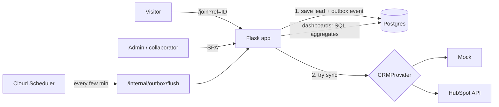

# Nexus Affiliate Gateway

**White-label referral tracking for promoter-driven lead generation.** Each promoter gets a personal referral link; every lead that signs up through it is stored with its attribution, synced to your CRM, and counted on a live leaderboard.

> **Status: planned.** This README is the design and the build plan. No code yet — see the [roadmap](#roadmap).

## The problem

Teams that rely on field promoters or affiliates need to know who brought in each lead. The usual setup is fragile:

- Attribution lives in a free-text field ("who referred you?") or depends on the promoter's name, which breaks when someone is renamed.
- Leads are pushed straight to the CRM. If the CRM API is down or rate-limited, the lead is lost.
- Counts and rankings are computed by querying the CRM on every page load: slow, expensive in API calls, and wrong once results are paginated.
- Everything is welded to one CRM vendor, so switching CRMs means rewriting the app.

## How Nexus solves it

1. **Referral links.** Every promoter has a stable short ID and a link like `https://your-domain/join?ref=a1b2c3d4`. The public form detects the `ref`, locks the promoter, and stores the lead.
2. **Local-first leads (outbox pattern).** The lead is saved in Nexus's own database *before* anything else happens. Then it is sent to the CRM; if that fails, it stays pending and is retried automatically. No lead is ever lost to a CRM outage.
3. **CRM adapters.** The CRM is a pluggable destination behind a `CRMProvider` interface:
   - `MockProvider` — no account needed; powers the public demo and the tests.
   - `HubSpotProvider` — real integration with the free HubSpot CRM (leads as Contacts, promoter ID as a custom property).
   - More providers (Zoho, GoHighLevel…) can be added without touching the rest of the app.
4. **Dashboards from your own data.** Lead counts per promoter and the leaderboard (today / this week / this month / all time) are SQL aggregates over the local database — fast and independent of CRM rate limits.
5. **White-label.** App name, colors and logo come from environment variables. One deployment per brand; no multi-tenancy.

## v1 scope

| In | Later |
|---|---|
| Promoter management (create, edit, archive — never hard delete) | Multi-tenancy |
| Referral link + public lead form | Payouts / commissions |
| Local lead storage + CRM sync with retries | More CRM adapters |
| Mock and HubSpot adapters | Webhooks from the CRM back into Nexus |
| Roles: admin and collaborator | |
| Leaderboard and per-promoter counts with time filters | |
| English / Spanish UI | |
| Demo mode with sample data | |

## Architecture

- One container serves both the JSON API and the compiled React app (same origin: no CORS configuration, cookies just work).
- Cloud Run scales to zero, so there is no long-running background worker. Failed syncs are retried by Cloud Scheduler calling a protected internal endpoint.

## Tech stack

| Layer | Choice | Why |
|---|---|---|
| Backend | **Flask** (app factory + blueprints) | Small, explicit; every piece is chosen and wired by hand |
| ORM / migrations | **SQLAlchemy 2.0 + Alembic** | Typed models; schema changes through versioned migrations, never `create_all()` |
| Validation | **Pydantic** | Request and config validation |
| Auth | Server-side sessions, hashed passwords, CSRF protection, login rate limiting | Simple and safe for a same-origin SPA |
| Database | **SQLite** (local) / **Postgres on Neon** (production) | Cloud Run's filesystem is ephemeral, so production data lives in a managed Postgres |
| Frontend | **React + TypeScript + Tailwind** (Vite) | Built once and served as static files by Flask |
| CRM | **HubSpot** (free CRM, private app token) + Mock | Real integration anyone can reproduce for free |
| Server | **Gunicorn** in Docker | Production WSGI server |
| Hosting | **Google Cloud Run** + Artifact Registry + Secret Manager + Cloud Scheduler | Serverless containers, scale to zero, secrets out of the code |
| CI/CD | **GitHub Actions** | Lint + tests on every PR; deploy to Cloud Run with Workload Identity Federation (no JSON keys) |
| Tests | **pytest** | Unit and integration tests against the Mock provider |

## Design decisions

- **The lead is written locally first.** The CRM is a destination, not the source of truth.
- **Attribution uses the promoter's immutable ID**, never the name.
- **Promoters are archived, not deleted**, so historical attribution survives.
- **The role comes from the user account.** There is no "log in as admin / collaborator" selector.
- **No secret has a default value.** The app refuses to start without `SECRET_KEY` and, when HubSpot is enabled, without its token.
- **Costs are capped.** Cloud Run runs with a low `max-instances` and the project has a budget alert, so even abuse of the public demo cannot produce a surprise bill.

## Known limitations

- **Cold starts:** after a period without traffic, the first request takes a few seconds while Cloud Run starts an instance.
- **HubSpot free plan:** it allows only a small number of custom properties, so Nexus uses one or two at most.
- **Retry latency:** a lead that failed to sync reaches the CRM on the next scheduler run (minutes), not instantly.

## Roadmap

- [ ] **0. Setup** — Google Cloud project with a budget alert, free HubSpot account, Neon database
- [ ] **1. Skeleton** — Flask app factory, blueprints, per-environment config, pytest, ruff, CI on GitHub Actions
- [ ] **2. Data model** — `User`, `Promoter`, `Lead`, `OutboxEvent` with Alembic migrations
- [ ] **3. Auth** — sessions, password hashing, CSRF, admin/collaborator roles, login rate limiting
- [ ] **4. Referral flow** — public `/join?ref=` form that stores the lead locally first
- [ ] **5. CRM adapters** — `CRMProvider` interface, Mock and HubSpot providers, outbox with retries
- [ ] **6. Dashboards** — per-promoter counts and leaderboard with today / week / month / all-time filters
- [ ] **7. Frontend** — React + TypeScript + Tailwind served by Flask, white-label theming, EN/ES
- [ ] **8. Containers** — Dockerfile with Gunicorn, docker compose with Postgres for local development
- [ ] **9. Deploy** — Cloud Run, Secret Manager, Cloud Scheduler for the outbox, automatic deploys from GitHub Actions
- [ ] **10. Release** — demo mode with sample data, architecture docs, screenshots, v1.0

## License

[MIT](LICENSE)
